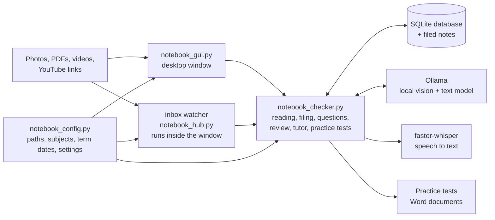

# Notebook Assistant

A local-first study notebook. Drop in a photo of your handwritten notes, a PDF, a lecture video or a YouTube link. It reads the page, files it by **school year, subject, term, week and day**, checks your working, summarises it, and builds a **spaced-repetition review list** from the things you find hard. Ask it questions in your own words (spelling mistakes are fine), work through a topic with a step-by-step **tutor**, or have it write a **practice test as a Word document** from your own notes.

Everything runs on your own computer using [Ollama](https://ollama.com): no cloud AI, no subscription, and your notes never leave your machine. The desktop window needs no browser and is light on memory and disk space.


> **Status: working prototype.** The logic is covered by 153 automated tests that use a stand-in for the model. How accurately a small local model reads *real* handwriting depends on your photos and hardware; measure it with [`tools/evaluate_reading.py`](tools/evaluate_reading.py) (see [Measuring accuracy](#measuring-accuracy)) rather than taking my word for it.

## What it does

| | |
|---|---|
| **Reads** | handwriting photos (vision model), typed and scanned PDFs, text files, lecture videos (Whisper), YouTube links (captions, or audio if there are none) |
| **Files** | `year / subject / term / week / day`, using a date in the file name, a date written on the page, the photo's own date, or the file date, in that order |
| **Checks** | tutor-style feedback on your working, and a list of mistakes it is confident about |
| **Remembers** | a review list with spaced repetition (1 day, 3 days, then growing); a coming test pulls reviews forward to the day before it |
| **Answers** | plain-English questions: *"sumarise yesterdays phisics"*, *"what did I get wrong in week 4"*, *"what did we learn about momentum"* |
| **Teaches** | a tutor that explains in small steps, asks one question at a time, and saves what you found hard |
| **Tests you** | writes a practice test (multiple choice, short answer, calculations) from your notes, or from your weak points, as a Word document with an answer key |
| **Saves space** | shrinks photos as they are filed, removes exact repeats, cleans up its temporary files, and can shrink or remove old photos on request |

## How it fits together



More detail in [`docs/ARCHITECTURE.md`](docs/ARCHITECTURE.md). The reasoning behind the main decisions, including what went wrong along the way, is in [`docs/DESIGN_NOTES.md`](docs/DESIGN_NOTES.md). New to this? Start with [`START_HERE.txt`](START_HERE.txt).

## Quick start (Windows)

You need [Python 3.11 or newer](https://www.python.org/downloads/) (tick "Add python.exe to PATH" when installing), [Ollama](https://ollama.com), and roughly 16 GB of RAM. A GPU with 4 to 6 GB should be enough for the small model used here.

```bash
ollama pull qwen2.5vl:3b
pip install -r requirements.txt
python notebook_hub.py setup all      # makes the folders (check notebook_config.py first)
```

Then double-click **`start_notebook.bat`**. One window opens, and while it is open it also watches your inbox folder.

On Linux or macOS: `python notebook_gui.py` (the window needs Tkinter: `sudo apt install python3-tk`).

### Folders

The **inbox** is where you drop things in. The **notebook folder** is where they are filed, along with the database. They must be two separate folders; both are set in [`notebook_config.py`](notebook_config.py).

```
~/NotebookPhotos/                 <- inbox: drop files here
    physics/                      <- a subfolder sets the subject
    maths-methods/
    ...
~/Notebook/                       <- filed notes + notebook.db
    2026/physics/term4/week04/day3/page_01.jpg
    Practice tests/physics_2026-10-30_week-4.docx
```

Choosing the subject (first match wins): a subfolder name, a file-name prefix like `physics_page3.jpg`, a `current_subject.txt` file, or the model's guess from the text.

## Using the window

| Tab | What it does |
|---|---|
| **Ask** | Type a question in your own words. |
| **Add notes** | Choose photos, PDFs or text files, or paste a YouTube link. Shows tutor feedback and where each page was filed. |
| **Tutor** | Pick a subject and topic, then answer the tutor's questions. "Finish" saves what you found hard. |
| **Practice test** | Say what to cover and how many questions; get a Word document with an answer key. |
| **Review** | Your due items, one at a time, with "Show the answer" and remembered / forgot / delete. |
| **Tests and weak points** | Record test dates (reviews are pulled in before them) and add things you can't remember. |
| **Storage** | See what is using disk space; shrink or remove old photos. |
| **Activity** | What the inbox watcher is doing. |
| **Help** | The most common fixes. |

**Ask in your own words:**

```
summarise day 3 of week 4 term 4 for physics 2026
sumarise yesterdays phisics
what did I get wrong in week four
what did we learn about projectle motion
recap last week specialist
make me a 5 question multiple choice test on projectile motion in physics
```

Spelling mistakes, nicknames (`maths`, `lit`, `spec`), number words (`week four`), `today` / `yesterday` / `last week` and weekday names are understood. The rules are in [`notebook_checker.py`](notebook_checker.py) (`understand()`); they use fuzzy string matching rather than the model, so they are fast and predictable.

**Practice tests.** The model writes questions from your notes only; the code checks each one (a multiple-choice question must have a matching answer, duplicates are dropped) and builds a Word document: questions in sections, answer boxes, marks, then an answer key with worked solutions, optionally in a separate file. *"Make me a test on what I got wrong"* uses your review list instead of your notes. A small model can still write a wrong answer, so the document says to check them.

**Command line** (the same things, from PowerShell): `python notebook_checker.py chat`, or `quiz`, `tutor`, `youtube`, `add`, `review`, `remind`, `status`, `storage`, `tidy`.

## Saving memory and disk space

- **Memory:** the desktop window is a single small Python process (about 32 MB when idle on my test machine, which uses Linux) with no browser and no web server. The model leaves memory a few minutes after you stop using it (`OLLAMA_KEEP_ALIVE` in the config) and reads less text at once (`OLLAMA_CONTEXT`), which is gentler on a 4 to 6 GB GPU.
- **Photos:** when a photo is filed it is stored at a maximum of 1800 pixels on the long side as a JPEG (quality 80), with phone camera data removed. The text was already read from the full-size original. Phone photos are often several MB each, and the stored copies are typically a few hundred KB. Adjust or switch off in the config.
- **PDFs:** a lossless tidy-up only; a PDF is never degraded.
- **Repeats:** an identical file dropped in twice is stored once, and the repeat is deleted.
- **Temporary files:** reading a page or a PDF no longer leaves copies behind.
- **Old photos:** the **Storage** tab (or `python notebook_checker.py tidy --days 60 --apply`) shrinks photos filed more than 60 days ago further. `--delete-photos` removes the pictures but keeps the text, summaries and review items. Without `--apply` it only shows a preview.
- **Videos:** a lecture video is deleted once its transcript is saved (switchable).

## Configuration

Everything personal lives in [`notebook_config.py`](notebook_config.py): the two folders, your subjects, nicknames for them, the term dates, window colours, and the settings above. The term dates supplied are Queensland state school dates for 2026 and 2027; change them to match your school. A subject can have its own calendar (for example university semesters) through `CALENDARS`. Put `logo.png` and/or `banner.png` in [`assets/`](assets/README.md) to personalise the window.

## Troubleshooting

See [`TROUBLESHOOTING.md`](TROUBLESHOOTING.md). The most common:

| Problem | What to try |
|---|---|
| "Ollama kept failing (error 503)" | Close other programs (browsers use a lot of memory), quit and reopen Ollama from the system tray, then run `ollama ps`. If it still fails, set `OLLAMA_CONTEXT = 2048` in `notebook_config.py`. |
| "Can't reach Ollama" | Open the Ollama app and check its tray icon. |
| "Ollama does not have the model" | `ollama pull qwen2.5vl:3b` |
| "No module named tkinter" | Re-run the Python installer, choose Modify, and tick "tcl/tk and IDLE". |
| "Making Word documents needs one extra package" | `pip install python-docx` |
| "No notes found" | Check the Storage tab for the notebook folder, and ask with a subject and a week or day. |

## Measuring accuracy

Reading handwriting is the hardest part, and it is easy to fool yourself. To measure it honestly:

1. Photograph 20 or more of your own pages the way you will in class.
2. Put each photo in a folder next to a `.txt` file with the correct transcription (`page_01.jpg` and `page_01.txt`).
3. Run:

```bash
python tools/evaluate_reading.py handwriting/test --out results.md
```

It reports the **character error rate** for each page and overall (the fraction of characters that must be corrected; lower is better).

## Testing

```bash
pip install -r requirements-dev.txt
pytest                      # on Linux without a display:  xvfb-run -a pytest
```

There are 153 tests. 138 run anywhere in seconds; 15 open the desktop window and are skipped when there is no display. They do not need Ollama, Whisper or a GPU, because the model is replaced by a fake. They cover date detection, term/week/day calculation, the question parser (with deliberately messy wording), filing and de-duplication, photo shrinking and temp-file cleanup, the storage report and tidy-up, the inbox watcher's decisions, spaced repetition, retry behaviour when Ollama is busy, the YouTube paths, practice-test generation and the Word files it builds, the accuracy tool, the desktop window and the optional browser app.

What the tests **cannot** tell you is how good a small model is at *your* handwriting, at spotting real mistakes, or at writing correct test answers; that is what the accuracy tool and your own checking are for.

## Limitations (please read)

- A 3-billion-parameter model makes mistakes. Handwriting can be misread, and the "possible mistakes" it flags are suggestions, not facts. Review lets you delete a wrong flag. **Practice-test answers can also be wrong**, so check them with a teacher or textbook.
- The tutor is a small model too. It can explain simply and quiz you, but it can be wrong.
- Dates written on a page are found with simple rules and can be misread; the filing message shows which date was used and where it came from.
- Shrinking photos is lossy. The text is read from the original first, but the stored picture is lower quality than the original.
- Downloading audio from YouTube can go against YouTube's terms. Captions are tried first; use the audio fallback only for videos you are allowed to use. School networks and VPNs often block it.
- Recording or transcribing a lesson may need your teacher's or school's permission.
- Developed and run on Windows; the automated tests were also run on Linux. The real model has not been load-tested, and the GitHub Actions workflow has not run yet.
- The optional browser version (`start_notebook_web.bat`, `notebook_app.py`) does not have the practice-test or storage tabs.

## Privacy

Notes, photos, audio and the database stay on your computer. `.gitignore` excludes the notebook folders, databases and media so they are not uploaded by accident. **Never commit your own notes.**

## Roadmap (ideas, not promises)

- Search by meaning (embeddings) instead of keywords.
- Check algebra line by line with a computer algebra system (SymPy) instead of trusting the model.
- Check practice-test answers the same way for calculation questions.
- A proper installer and desktop shortcut.
- Connect it to a wearable display; see [`glasses/`](glasses/) for the early design.

## Related: smart-glasses concept

[`glasses/`](glasses/) holds a design guide and prototype script for a pair of glasses that show short tutor replies in your field of view. It is a **design and software prototype only. No hardware has been built.**


